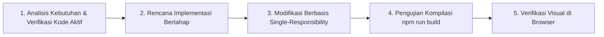

# PlanetKuu — Eksplorasi Tata Surya 3D Interaktif Ramah Anak

> **Karya untuk M-One Telkomsel Competition**  
> **Tema Utama:** *Innovating Education Through Technology*  
> **Subtema:** *Web Education for Kids (untuk anak SD)*  
> **Aplikasi:** [PlanetKuu](https://github.com/JoshNells13/planetkuu)  

---

## Daftar Isi
1. [Ringkasan Eksekutif](#ringkasan-eksekutif)
2. [Latar Belakang & Rumusan Masalah](#latar-belakang--rumusan-masalah)
3. [Solusi Inovatif: PlanetKuu](#solusi-inovatif-planetkuu)
4. [Kesesuaian Tema & Subtema Kompetisi](#kesesuaian-tema--subtema-kompetisi)
5. [Fitur Unggulan Proyek](#fitur-unggulan-proyek)
6. [Pedagogi & Keselarasan Kurikulum Merdeka](#pedagogi--keselarasan-kurikulum-merdeka)
7. [Arsitektur & Tumpukan Teknologi (Tech Stack)](#arsitektur--tumpukan-teknologi-tech-stack)
8. [Struktur Direktori Proyek](#struktur-direktori-proyek)
9. [Panduan Instalasi & Menjalankan Aplikasi](#panduan-instalasi--menjalankan-aplikasi)
10. [Aksesibilitas & Optimalisasi Mobile](#aksesibilitas--optimalisasi-mobile)
11. [Jurnal Prompt Terkurasi & Log Mentah Awal–Akhir](#jurnal-prompt-terkurasi--log-mentah-awal-akhir)
12. [Dokumen Acuan AI Agent untuk Seluruh Task (Master Guidelines)](#dokumen-acuan-ai-agent-untuk-seluruh-task-master-guidelines)
13. [Rencana Pengembangan Lanjutan (Roadmap)](#rencana-pengembangan-lanjutan-roadmap)
14. [Tim Pengembang & Lisensi](#tim-pengembang--lisensi)

---

## Ringkasan Eksekutif

**PlanetKuu** adalah platform web edukasi sains interaktif berbasis 3D WebGL yang dirancang khusus untuk siswa Sekolah Dasar (Fase B & C / Kelas 3–6 SD). Mengusung visi *"Menghadirkan Laboratorium Alam Semesta Langsung ke Genggaman Anak Indonesia"*, PlanetKuu meniadakan konsep halaman arahan statis (*landing page*) yang membosankan dan langsung membawa siswa masuk ke dalam simulasi tata surya 3D yang hidup (*living 3D galaxy*).

Melalui kombinasi grafis 3D interaktif real-time, narasi suara ramah anak oleh maskot **Astro**, musik latar kosmik prosedural, 25 efek suara sentuhan haptik, inspektur struktur lapisan inti planet, hingga gamifikasi berbasis misi dan lencana (*mission-based learning*), PlanetKuu mengubah materi astronomi yang abstrak menjadi pengalaman eksplorasi kinestetik yang tak terlupakan.

---

## Latar Belakang & Rumusan Masalah

Pendidikan Ilmu Pengetahuan Alam dan Sosial (IPAS) di tingkat Sekolah Dasar di Indonesia menghadapi tantangan nyata:

1. **Abstraksi Konsep Kosmik**: Materi astronomi seperti rotasi, revolusi, pergantian siang-malam, skala ukuran planet, dan struktur tata surya sulit divisualisasikan hanya melalui diagram 2D statis di buku paket cetak.
2. **Kesenjangan Perangkat & Aksesibilitas**: Sebagian besar media pembelajaran digital interaktif berbasis aplikasi berat (*desktop software* atau *game engine bulky*) yang memerlukan spesifikasi tinggi dan proses instalasi rumit, sehingga tidak ramah untuk smartphone orang tua atau gawai sekolah berdaya rendah.
3. **Rendahnya Keterlibatan Mandiri Siswa**: Konten digital anak saat ini kerap dipenuhi iklan, jebakan distraksi, atau sekadar video satu arah tanpa adanya elemen inkuiri mandiri (*self-directed inquiry learning*).

---

## Solusi Inovatif: PlanetKuu

PlanetKuu hadir menjawab tantangan tersebut dengan memanfaatkan teknologi web modern terkini:

- **Eksplorasi 3D Tanpa Hambatan Instalasi**: Cukup membuka peramban web (*browser*) di smartphone, tablet, atau komputer tanpa perlu unduh aplikasi tambahan (zero installation).
- **Pendekatan Inkuiri Terpandu (Guided Discovery)**: Siswa didampingi oleh **Astro si Sahabat Penjelajah**, maskot astronot cilik dengan suara berbasis *Web Speech API* yang mengajak siswa berkeliling tata surya layaknya studi tur antariksa langsung.
- **Visualisasi Lapisan Dalam Planet (Planet Layer Inspector)**: Anak dapat membedah struktur kerak, mantel, dan inti planet secara interaktif 360 derajat.
- **Audio Sintesis Prosedural Offline**: Musik latar kosmik dan efek suara diciptakan secara sintetis menggunakan *Web Audio API* langsung di dalam memori peramban tanpa mengunduh file MP3/WAV besar, menjadikannya hemat kuota internet dan bekerja optimal di jaringan terbatas.

---

## Kesesuaian Tema & Subtema Kompetisi

### 1. Tema: Innovating Education Through Technology
PlanetKuu mendemokratisasi akses edukasi sains canggih dengan mengubah komputasi grafis 3D berkemampuan tinggi (Three.js & WebGL) ke dalam format web yang ringan dan mudah diakses di seluruh pelosok Indonesia. Teknologi tidak lagi menjadi penghalang, melainkan jembatan yang menghubungkan rasa ingin tahu anak-anak dengan keagungan alam semesta.

### 2. Subtema: Web Education for Kids (untuk anak SD)
Seluruh antarmuka, bahasa narasi, dan mekanika interaksi dirancang khusus untuk karakteristik psikologis dan motorik anak usia 8–12 tahun:
- **Bahasa Ramah Anak & Konseptual Sederhana**: Menghindari rumus rumit; konsep astronomi dijelaskan dengan analogi benda sehari-hari (misal: perbandingan ukuran Bumi dan Matahari dengan kacang polong dan bola basket).
- **Target Sentuh Ergonomis (Touch-Friendly)**: Seluruh tombol pada perangkat mobile memiliki area sentuh minimum 44 x 44 piksel dengan umpan balik suara klik instan.
- **Zona Aman Bebas Distraksi**: 100% bebas iklan, tanpa formulir pendaftaran akun rumit, dan aman bagi anak (*child-safe by design*).
- **Desain Modern Obsidian Hitam Antariksa**: Palet warna galaksi gelap (*deep space black*) yang elegan tanpa emoji sembarangan, menjaga wibawa edukasi sains sekaligus menawan secara visual.

---

## Fitur Unggulan Proyek

### 1. Interactive 3D Solar System Engine
- Simulasi orbital presisi yang menampilkan Matahari dan delapan planet (Merkurius, Venus, Bumi, Mars, Jupiter, Saturnus dengan sistem cincin, Uranus dengan kemiringan aksial unik, dan Neptunus).
- OrbitControls dinamis: putar sudut pandang 360 derajat, cubit untuk perbesar/perkecil (*pinch to zoom*), dan geser sudut pandang bebas.
- Kendali simulasi: Jeda (*pause*), putar ulang, serta percepat rotasi/revolusi (0.5x, 1x, 2x, 5x).
- Pengalih garis orbit (*orbit lines*) dan label nama planet 3D interaktif.

### 2. Tur Berkeliling Dipandu Astro (Astro Guided Tour) & Pemandu Langit
- Fitur tur berpemandu otomatis dan manual berisi 10 perhentian antariksa terkurasi:
  1. Matahari — Inti Kehidupan Tata Surya
  2. Merkurius — Pelari Cepat yang Panas & Dingin
  3. Venus — Saudara Kembar Bumi yang Membara
  4. Bumi & Bulan — Rumah Kehidupan Kita
  5. Mars — Gurun Karat Berwarna Merah
  6. Sabuk Asteroid — Batuan Pembentuk Tata Surya
  7. Jupiter — Sang Raksasa Gas Pelindung
  8. Saturnus — Mahkota Cincin Permata Kosmik
  9. Uranus & Neptunus — Penjaga Dingin di Tepi Tata Surya
  10. ISS & Pangkalan Antariksa Masa Depan
- **Pelacakan Orbit Real-Time (*Live Orbital Lock-on*)**: Kamera 3D secara dinamis melacak koordinat aktual setiap planet yang sedang bergerak mengitari Matahari (`celestialRegistry.ts`), memastikan teropong selalu membidik tepat sasaran pada planet target (bukan ruang hampa).
- **Pemandu Langit (*Celestial Guide Modal*)**: Katalog 16 objek kosmik dengan tombol "Arahkan Teropong" yang mengunci dan mengikuti objek langit secara langsung.
- Dilengkapi pembacaan teks suara berbahasa Indonesia langsung (*text-to-speech* otomatis dengan opsi bisu), kotak fakta seru komparasi dunia nyata, dan navigasi linier.

### 3. Planet Inspector 3D (Bedah Lapisan Inti Planet)
- Fitur inspektur planet mendalam:
  - **Mode Permukaan 3D**: Menjelajahi fitur geologis dan titik penting (*hotspots*) seperti Bintik Merah Raksasa Jupiter, Gunung Olympus di Mars, atau Kawah Caloris di Merkurius.
  - **Mode Lapisan Inti 3D**: Membelah planet secara visual untuk mengamati kerak (*crust*), mantel silikat (*mantle*), dan inti besi/nikel cair (*core*) beserta penjelasannya.

### 4. Laboratorium Sejarah Sains & Easter Eggs Tersembunyi
Menumbuhkan apresiasi anak terhadap tonggak sejarah sains manusia:
- **Komet Halley**: Mengetuk komet es melintas untuk mengamati sublimasi ekor gas.
- **Wahana Voyager 1**: Mengamati piringan emas (*Golden Record*) wahana buatan manusia terjauh di ruang antarbintang.
- **Stasiun Luar Angkasa Internasional (ISS)**: Menemukan laboratorium mengorbit tempat para astronaut tinggal dan melakukan eksperimen gravitasi mikro.
- **Teleskop Antariksa James Webb (JWST)**: Mempelajari cermin heksagonal emas pelacak cahaya bintang purba.
- **Pendaratan Apollo 11 di Bulan**: Meneliti jejak kaki astronaut pertama, modul pendarat *Eagle*, dan plakat perdamaian Bulan.
- **Bintang Jatuh (Meteor)**: Menangkap meteor melintas berkecepatan tinggi untuk melatih refleks motorik anak.
- **Sabuk Asteroid & Sabuk Kuiper**: Berinteraksi dengan jutaan batuan luar angkasa dan planet kerdil Pluto.

### 5. Gamifikasi Pembelajaran Berbasis Misi (Misi Penjelajah Cilik)
- **Sistem Pengalaman (XP) & Peringkat**: Dari *Kadet Pemula*, *Pengamat Bintang*, *Pelacak Orbit*, hingga *Laksamana Bintang*.
- **5 Misi Kurikulum Berjenjang**:
  - Misi 1: Mencari Planet Merah (Identifikasi Mars)
  - Misi 2: Penjaga Orbit (Memahami revolusi mengitari Matahari)
  - Misi 3: Misteri Siang dan Malam (Eksperimen rotasi Bumi)
  - Misi 4: Rahasia Cincin Saturnus (Eksplorasi cincin es partikel)
  - Misi 5: Tantangan Kuis Tata Surya (Evaluasi pemahaman konsep)
- **10 Koleksi Lencana (Badges)**: Penghargaan visual menarik yang tersimpan permanen di penyimpanan lokal (*localStorage*) tanpa risiko hilang saat laman dimuat ulang.

### 6. Audio Kosmik Prosedural (BGM Ambient & 25 Sound Effects)
- **Cosmic BGM Engine**: Musik instrumental luar angkasa santai berbasis gelombang sinus dan segitiga polifonik harmonis (43 Hz – 392 Hz) dengan denting starlight twinkle.
- **25 Efek Suara Haptik Unik**:
  - Suara klik sentuhan adaptif dengan variasi frekuensi acak alami.
  - Resonansi surya (*solar pulse*) saat menyentuh Matahari.
  - Bunyi telemetri radio astronaut retro (*NASA radio telemetry*) pada ISS dan Bulan.
  - Sapuan optik sensor teleskop (*telescope scan chime*) pada JWST.
  - Sinyal antarbintang pada Voyager 1 dan desingan es Komet Halley.
  - Suara vokal ceria robotik maskot Astro saat berinteraksi.
  - Nada melodi keberhasilan kuis dan bunyi empuk ramah anak saat salah menjawab.
  - Hitungan mundur peluncuran roket dan deru gemuruh mesin roket menembus orbit.

### 7. Ensiklopedia & Alat Komparasi Planet
- Katalog astronomi komprehensif berisi data radius, jarak dari Matahari, suhu rata-rata, gravitasi, jumlah satelit alami, dan lama rotasi/revolusi.
- **Komparasi 2 Planet Berdampingan**: Anak dapat memilih dua planet mana saja untuk membandingkan ukuran dan karakteristik fisik secara langsung.

### 8. Simulator Peluncuran Roket Bumi
- Simulasi lepas landas roket dengan hitungan mundur telemetri, animasi pembakaran bahan bakar bertingkat, penembusan atmosfer, hingga penempatan satelit di orbit stabil Bumi.

---

## Pedagogi & Keselarasan Kurikulum Merdeka

PlanetKuu dirancang selaras dengan **Capaian Pembelajaran (CP) IPAS Kurikulum Merdeka**:

| Elemen Kurikulum | Capaian Pembelajaran SD (Fase B/C) | Penerapan di PlanetKuu |
| :--- | :--- | :--- |
| **Pemahaman IPAS** | Mengidentifikasi urutan planet dan karakteristik tata surya. | Eksplorasi 3D 8 planet dengan data visual dan ukuran relatif. |
| **Sistem Bumi & Antariksa** | Memahami gerak rotasi dan revolusi Bumi serta dampaknya (siang-malam & musim). | Kontrol interaktif rotasi sumbu Bumi dan garis revolusi mengelilingi Matahari. |
| **Keterampilan Proses** | Mengamati, memprediksi, membandingkan, dan mengomunikasikan hasil penyelidikan. | Fitur *Bandingkan 2 Planet*, inspeksi lapisan dalam, dan kuis refleksi interaktif. |
| **Profil Pelajar Pancasila** | Bernalar Kritis, Mandiri, dan Kreatif. | Model inkuiri mandiri berbasis misi dan pemecahan misteri antariksa. |

---

## Arsitektur & Tumpukan Teknologi (Tech Stack)


- **Frontend Core**: React 19, TypeScript, Vite
- **3D Graphics & Rendering**: Three.js, `@react-three/fiber`, `@react-three/drei`
- **Audio Synthesizer Engine**: Native Web Audio API (zero external assets, 0ms latency)
- **Voice Narration**: Web Speech API (`SpeechSynthesisUtterance` id-ID)
- **Styling Architecture**: Vanilla CSS murni dengan CSS Custom Properties (*Tokens: Galaxy Obsidian, Starlight Silver, Solar Gold*)
- **Icons**: Lucide React
- **Confetti Celebration**: Canvas Confetti

---

## Struktur Direktori Proyek

```text
planetkuu/
├── index.html                   # Entry point dokumen HTML5 & SEO Meta
├── package.json                 # Konfigurasi dependensi & skrip build
├── tsconfig.json                # Konfigurasi TypeScript
├── vite.config.ts               # Konfigurasi Vite bundler
├── public/                      # Aset statis favicon dan tekstur
└── src/
    ├── main.tsx                 # Root React mounting
    ├── App.tsx                  # Komponen orkestrator utama PlanetKuu
    ├── App.css                  # Desain sistem responsif, Dock, & Glassmorphism
    ├── index.css                # Variabel CSS Tokens & Reset Global
    ├── components/
    │   ├── 3d/                  # Komponen 3D Scene WebGL
    │   │   ├── SolarSystem.tsx  # Tata surya utama & orbit
    │   │   ├── Sun.tsx          # Matahari bersinar dengan corona
    │   │   ├── Planet.tsx       # Model 8 planet, rotasi, atmosfer
    │   │   ├── AsteroidBelt.tsx # Sabuk Asteroid dinamis
    │   │   ├── KuiperBelt.tsx   # Sabuk Kuiper dingin
    │   │   ├── CosmicEasterEggs.tsx # Meteor, ISS, JWST
    │   │   ├── HalleyComet.tsx  # Komet Halley dengan ekor gas
    │   │   ├── VoyagerProbe.tsx # Wahana Voyager 1 & Golden Record
    │   │   ├── Pluto.tsx        # Planet kerdil Pluto & satelit Charon
    │   │   └── PlanetInspector3D.tsx # Bedah lapisan dalam & hotspot
    │   ├── guide/               # Tur Berkeliling & Panduan
    │   │   ├── AstroGuidedTour.tsx # Tur terpandu interaktif
    │   │   └── CelestialGuideModal.tsx # Panduan pencarian objek antariksa
    │   ├── mascot/              # Maskot Astronaut Astro
    │   │   ├── AstroMascot.tsx  # Avatar SVG kartun 3D responsif
    │   │   └── AstroDialogue.tsx# Balon dialog kontekstual Astro
    │   ├── modals/              # Dialog Modal Edukasi
    │   │   ├── PlanetDetailModal.tsx   # Detail planet & aktivitas
    │   │   ├── MissionDashboard.tsx    # Dasbor misi penjelajah
    │   │   ├── AchievementsModal.tsx   # Lemari piala & lencana
    │   │   ├── EncyclopediaModal.tsx   # Ensiklopedia & perbandingan
    │   │   ├── QuizModal.tsx           # Kuis evaluasi pemahaman
    │   │   ├── RocketLaunchOverlay.tsx # Simulator peluncuran roket
    │   │   ├── SpaceStationModal.tsx   # Info edukasi stasiun ISS
    │   │   ├── TelescopeModal.tsx      # Info edukasi JWST
    │   │   ├── LunarEasterEggModal.tsx # Rekonstruksi Apollo 11
    │   │   ├── AstroTalkModal.tsx      # Tanya jawab astronomi
    │   │   └── SettingsModal.tsx       # Pengaturan audio & grafis
    │   └── ui/                  # Komponen Navigasi & HUD
    │       ├── FloatingHUD.tsx  # Header mengambang & Mobile Dock
    │       └── WebGLFallback.tsx# Tampilan alternatif jika WebGL mati
    ├── context/
    │   └── GameContext.tsx      # Manajemen state terpusat & audio binding
    ├── data/                    # Basis Pengetahuan Astronomi
    │   ├── planets.ts           # Data sains 8 planet & Matahari
    │   ├── missions.ts          # Data misi edukatif & lencana
    │   ├── tour.ts              # Naskah 10 perhentian Tur Astro
    │   ├── quiz.ts              # Bank soal kuis Kurikulum Merdeka
    │   └── guide.ts             # Data panduan objek langit
    ├── types/                   # Definisi TypeScript
    │   ├── astronomy.ts         # Tipe planet, orbit, lapisan, koordinat
    │   └── gamification.ts      # Tipe misi, level, lencana, preferensi
    └── utils/                   # Utilitas Sistem
        ├── sound.ts             # Web Audio API Synthesizer (25 SFX)
        ├── bgm.ts               # Mesin Musik Kosmik Prosedural
        ├── speech.ts            # Web Speech API Narator Indonesia
        ├── textures.ts          # Generator tekstur prosedural planet
        └── storage.ts           # Penyimpanan lokal terenkapsulasi
```

---

## Panduan Instalasi & Menjalankan Aplikasi

Pastikan pada komputer Anda telah terpasang **Node.js** (versi 18.0 atau lebih baru) dan pengelola paket `npm`.

### 1. Kloning Repositori
```bash
git clone https://github.com/JoshNells13/planetkuu.git
cd planetkuu
```

### 2. Instalasi Dependensi
```bash
npm install
```

### 3. Menjalankan di Server Pengembangan Lokal
```bash
npm run dev
```
Setelah perintah dijalankan, buka peramban Anda di alamat yang tertera (biasanya `http://localhost:5173`).

### 4. Membangun Bundel Produksi (*Production Build*)
```bash
npm run build
```
Hasil kompilasi siap publikasi akan berada di folder `dist/` dengan ukuran bundel yang telah dioptimasi dan terkompresi secara efisien.

---

## Aksesibilitas & Optimalisasi Mobile

PlanetKuu memprioritaskan prinsip **Mobile-First Responsive Design**:
- **Mobile Navigation Dock**: Tombol pintas navigasi di bagian bawah layar yang mudah dijangkau oleh ibu jari anak saat memegang ponsel dalam mode satu tangan maupun dua tangan.
- **Dukungan Sentuhan Multi-Gesture**: Dukungan penuh sentuhan satu jari untuk rotasi, dua jari untuk perbesar (*pinch zoom*), dan ketukan instan untuk pemilihan planet.
- **Fallback Ramah Perangkat Lawas**: Dilengkapi deteksi kapabilitas WebGL otomatis (`WebGLFallback.tsx`). Jika perangkat lawas tidak mendukung akselerasi 3D, aplikasi tetap menyajikan katalog ensiklopedia sains secara lancar.
- **Pengaturan Kualitas Grafis**: Pengguna dapat mengatur tingkat ketajaman grafis (*Tinggi, Sedang, Rendah*) di menu pengaturan untuk menghemat baterai perangkat.

---

## Jurnal Prompt Terkurasi & Log Mentah Awal–Akhir

Bagian ini mendokumentasikan metodologi rekayasa prompt (*prompt engineering*) dan evolusi siklus pengembangan perangkat lunak (*Software Development Life Cycle / SDLC*) kolaboratif manusia dan AI Agent (*Human-AI Pair Programming*) dari awal inisiasi proyek hingga tahap produksi kompetisi.

### 1. Jurnal Prompt Terkurasi (Curated Prompt Journal)

#### Iterasi 1 — Inisiasi Fondasi & Eksekusi PRD Awal
- **Prompt Pengguna:**
  ```text
  @[PRD.md] @[PRD-2.md] Eksekusi
  ```
- **Niat & Konteks:** Memulai proyek dari nol berdasarkan dua dokumen kebutuhan produk (*Product Requirement Document*). Diperlukan arsitektur tata surya 3D WebGL, sistem kontrol orbit, data astronomi 8 planet, maskot astronot Astro, serta sistem misi dan gamifikasi dasar.
- **Tindakan & Solusi Teknis AI Agent:**
  - Menginisialisasi infrastruktur React 19 + TypeScript + Three.js + React Three Fiber (`@react-three/fiber`, `@react-three/drei`).
  - Merancang data terstruktur astronomi di `src/data/planets.ts`, model misi di `src/data/missions.ts`, dan bank soal kuis di `src/data/quiz.ts`.
  - Membangun `GameContext.tsx` sebagai *central state manager* untuk memelihara status planet terpilih, modal aktif, kecepatan simulasi, XP, dan lencana.
- **Hasil:** Aplikasi 3D pertama kali berhasil dirender dengan Matahari, 8 planet, garis edar orbit bercahaya, dan antarmuka mengambang (*Floating HUD*).

#### Iterasi 2 — Penyelesaian Seluruh Modal Edukasi
- **Prompt Pengguna:**
  ```text
  lanjutkan
  ```
- **Niat & Konteks:** Melanjutkan pembangunan seluruh modal interaktif yang dispesifikasikan di PRD tanpa terputus.
- **Tindakan & Solusi Teknis AI Agent:**
  - Membangun modal edukasi lengkap: `PlanetDetailModal.tsx` (detail sains & aktivitas planet), `MissionDashboard.tsx` (dasbor misi), `AchievementsModal.tsx` (lemari piala lencana), `EncyclopediaModal.tsx` (katalog dan pembanding 2 planet), `QuizModal.tsx` (evaluasi 5 soal), dan `RocketLaunchOverlay.tsx` (simulator peluncuran roket).
  - Mengintegrasikan penyimpanan lokal `localStorage` di `src/utils/storage.ts` agar pencapaian anak tidak hilang saat halaman di-refresh.
- **Hasil:** Seluruh fitur fungsional MVP selesai dan terhubung ke sistem gamifikasi.

#### Iterasi 3 — Inspektur Lapisan 3D & Easter Eggs Sains Antariksa
- **Prompt Pengguna:**
  ```text
  UPDATE
  -Bisa Lihat Detail 3d Masing Masing Planet Ketika Dipilih Atau Dipencet 
  -Ada easter egg kayak tiba2 meteor lewat,cahaya,atau aktivitas2 manusia yang ada di luar bumi
  ```
- **Niat & Konteks:** Memperdalam nilai edukasi sains agar anak tidak hanya melihat tampilan luar, melainkan dapat membedah struktur dalam planet dan menemukan bukti aktivitas manusia di luar angkasa.
- **Tindakan & Solusi Teknis AI Agent:**
  - Mengembangkan komponen `PlanetInspector3D.tsx` dengan dua mode: **Mode Permukaan 3D & Hotspot** (kawah, gunung berapi, badai bintik merah) dan **Mode Struktur Lapisan Inti 3D** (kerak, mantel, inti logam).
  - Mengembangkan komponen 3D `CosmicEasterEggs.tsx`:
    - **Meteor Melintas**: Bintang jatuh acak yang dapat diklik/ditangkap anak untuk melatih refleks motorik.
    - **Stasiun Luar Angkasa ISS**: Laboratorium astronaut manusia di orbit Bumi.
    - **Teleskop James Webb (JWST)**: Teleskop optik inframerah dengan cermin heksagonal emas.
    - **Wahana Voyager 1**: Objek terjauh buatan manusia pembawa *Golden Record*.
    - **Komet Halley**: Komet es dengan ekor sublimasi gas bercahaya.
    - **Pendaratan Apollo 11 di Bulan**: Rekonstruksi jejak kaki pertama manusia di Bulan.
- **Hasil:** Tata surya menjadi hidup, penuh misteri eksplorasi yang mendorong rasa ingin tahu inkuiri anak.

#### Iterasi 4 — Redesain Visual Galaxy Black Obsidian & Sabuk Asteroid
- **Prompt Pengguna:**
  ```text
  Update
  -UI nya ganti yang awal warna nya Biru Glow menjadi Hitam Modern
  -Pastikan Tata Surya nya ngak sepi biar banyak pengetahuan
  -Pastikan Ada Fitur Guide jadi ada tomol untuk Mengarahkan Planet2 apa saja ata apa saja yang ada di tata surya
  ```
- **Niat & Konteks:** Mengganti skema warna biru glow yang terlalu mencolok dan melelahkan mata menjadi hitam galaksi modern kontras tinggi (*Galaxy Black Obsidian*), memperkaya objek langit, dan membuat menu pemandu pencarian objek.
- **Tindakan & Solusi Teknis AI Agent:**
  - Merombak CSS Tokens di `src/index.css` dan `src/App.css`: latar belakang `#000000`, panel `#0a0b0e` bertekstur kaca gelap (*glassmorphism*), aksen emas surya `#fbbf24`, dan batas halus transparan.
  - Menambahkan komponen 3D `AsteroidBelt.tsx` (350 pecahan batuan asteroid di antara Mars dan Jupiter) dan `KuiperBelt.tsx` (400 partikel es di luar Neptunus).
  - Menambahkan planet kerdil `Pluto.tsx` beserta satelitnya Charon.
  - Membangun `CelestialGuideModal.tsx` yang memungkinkan anak memilih objek langit apa saja dan kamera akan meluncur terbang (*fly to target*) secara mulus.
- **Hasil:** Tampilan antarmuka terasa sangat premium, nyaman di mata anak, dan tata surya kaya akan materi geografi kosmik.

#### Iterasi 5 — Brand Identity PlanetKuu & Pembersihan Total Emoji
- **Prompt Pengguna:**
  ```text
  Update
  -Pastikan UI Nya ngak ada yang warna Biru Glow Jadi warna HItam Jadi Seakan KIta Lagi Di Galaxi
  -Pastikan Jangan Pakai Emoji
  -Nama APP nya PlanetKuu
  ```
- **Niat & Konteks:** Mengukuhkan identitas nama resmi aplikasi menjadi **PlanetKuu**, menegakkan aturan baku tanpa emoji di seluruh antarmuka dan kode, serta memastikan estetika hitam galaksi yang murni.
- **Tindakan & Solusi Teknis AI Agent:**
  - Melakukan audit teks dan kode lintas repositori, mengganti semua karakter emoji dengan ikon SVG resmi dari pustaka Lucide React (Compass, Sparkles, Orbit, Trophy, Rocket, Globe, dll.).
  - Mengganti seluruh penyebutan nama aplikasi menjadi **PlanetKuu**.
  - Mengeliminasi sisa bayangan biru (*blue box-shadow*) dan menggantinya dengan kilau emas surya dan obsidian.
- **Hasil:** Antarmuka berwibawa, profesional, bersih, dan sesuai standar kompetisi teknologi nasional.

#### Iterasi 6 — Inovasi Tur Interaktif Ramah Anak Dipandu Maskot Astro
- **Prompt Pengguna:**
  ```text
  Pastikan Fitur Guide atau tour nya jangan pencet2 kaak gitu maksud saya ketika di pencet maka yang mengarahkan nya yatitu si astro jadi kayak anak SD yang bener2 di ajak berkeliling gitu
  ```
- **Niat & Konteks:** Menghilangkan kelemahan fitur panduan lama yang hanya berupa daftar tombol klik mekanis. Pengguna ingin pengalaman studi tur edukatif yang riil di mana maskot **Astro** memimpin anak berkeliling dari planet ke planet layaknya kakak pemandu wisata antariksa yang ramah dan menyenangkan.
- **Tindakan & Solusi Teknis AI Agent:**
  - Merancang basis data 10 perhentian tur di `src/data/tour.ts` dengan naskah dialog ceria ramah anak dan kotak perbandingan konkret dunia nyata.
  - Membangun mesin narator suara bahasa Indonesia `src/utils/speech.ts` menggunakan *Web Speech API* (`id-ID`) yang secara otomatis membacakan cerita Astro di setiap perhentian.
  - Mengembangkan komponen tur `src/components/guide/AstroGuidedTour.tsx` dengan banner mengambang "Tur Astro • X/10", avatar Astro berekspresi dinamis (*waving, explaining, celebrating*), garis waktu dot perhentian, tombol putar otomatis (*autoplay* 10 detik/planet), dan kendali maju-mundur.
- **Hasil:** Fitur unggulan utama terwujud: anak SD benar-benar merasa diajak berkeliling menjelajahi keajaiban tata surya oleh sahabat astronotnya.

#### Iterasi 7 — Musik Latar Prosedural & Optimalisasi Responsif Mobile
- **Prompt Pengguna:**
  ```text
  -pastikan ada bg music nya
  -Pastikan responsve di semua device apalagi mobile bisa di pencet semua dan tampilan jelas
  ```
- **Niat & Konteks:** Menambahkan musik atmosfer antariksa yang menenangkan serta menjamin situs responsif 100% di semua ukuran gawai (terutama smartphone layar kecil) dengan tombol yang mudah dipencet tanpa elemen bertumpukan.
- **Tindakan & Solusi Teknis AI Agent:**
  - Membangun mesin musik kosmik prosedural offline di `src/utils/bgm.ts` (*CosmicBGMManager*) menggunakan osilator gelombang sinus/segitiga polifonik bertangga nada santai (C minor9, Ab maj7, Eb maj9, Bb sus4) dan denting bintang pentatonik twinkle tanpa aset file audio eksternal.
  - Menyediakan tombol pintas Musik di bar atas dan di modal Pengaturan.
  - Mendesain ulang tata letak mobile di `src/App.css` dan `FloatingHUD.tsx`:
    - Menghadirkan **Mobile Dock** di bagian bawah layar ponsel berisi tombol-tombol utama (Tur Astro, Tata Surya, Misi, Lencana, Ensiklopedia, Kuis, Roket, dan Kecepatan).
    - Memposisikan kartu bicara dialog Astro di atas dock (`bottom: 74px`) agar tidak lagi menutupi tombol simulasi.
    - Menetapkan area target sentuh tombol minimal 44 x 44 piksel (*Apple HIG & Android Material Guidelines*).
- **Hasil:** Aplikasi terdengar imersif dan memiliki UX mobile kelas satu yang sangat ramah jari anak.

#### Iterasi 8 — 25 Efek Suara Haptik & Detail Audio Kosmik
- **Prompt Pengguna:**
  ```text
  Pastikan Ada Sound Effet nya saat pencet2 dan suara2 kecil detail lainnya
  ```
- **Niat & Konteks:** Menghadirkan umpan balik suara sentuhan (*auditory tactile feedback*) pada setiap aksi pencet tombol serta suara-suara detail kosmik di seluruh sudut aplikasi.
- **Tindakan & Solusi Teknis AI Agent:**
  - Mengembangkan `src/utils/sound.ts` dengan 25 efek suara prosedural Web Audio API:
    - *Tactile Click* dengan variasi pitch acak mikro alami.
    - *Micro-Hover Tick* (1420Hz) saat melintasi tombol/kartu.
    - *Tab Switch Slide* pada pergantian kategori.
    - *Modal Open Whoosh* & *Modal Close Descend*.
    - *Solar Core Pulse* saat Matahari disentuh.
    - *NASA Comms Telemetry Beeps* pada stasiun ISS dan pendaratan Apollo 11.
    - *Telescope Scan Chime* pada Teleskop James Webb.
    - *Voyager Signal Pulse* pada Voyager 1.
    - *Comet Whoosh* pada Komet Halley.
    - *Pluto Chime* dan *Asteroid Pebble Tap* pada sabuk batuan.
    - *Astro Blips & Happy Chirps* saat berinteraksi dengan maskot.
    - *Quiz Correct Melodic Chime* & *Quiz Wrong Gentle Thud*.
    - *Rocket Launch Telemetry Countdown & Thruster Roar*.
  - Menanamkan *Global Pointerdown & Pointerover Listener* sehingga 100% tombol di seluruh layar otomatis mengeluarkan suara klik responsif seketika.
- **Hasil:** Setiap interaksi terasa hidup, memuaskan, dan memberikan umpan balik nyata bagi anak.

#### Iterasi 9 & 10 — Dokumentasi Kompetisi & Validasi Kesesuaian Tema
- **Prompt Pengguna:**
  ```text
  Sekaraan Buat readme nya untuk dokumetasi projek ini dan untuk Tema Loma M-One Telkomsel Competition 
  Website sesuai tema "Innovating Education Through Technology" dengan subtema "Web Education for Kids (untuk anak SD)"
  ```
  ```text
  dan pastikan isi website ini apakah sesusai dengan Website sesuai tema "Innovating Education Through Technology" dengan subtema "Web Education for Kids (untuk anak SD)"
  ```
- **Niat & Konteks:** Menyusun dokumentasi komprehensif berstandar dewan juri M-One Telkomsel Competition dan memastikan seluruh isi materi, meta tags, dan fitur 100% selaras dengan Kurikulum Merdeka IPAS SD.
- **Tindakan & Solusi Teknis AI Agent:**
  - Menyusun `README.md` komprehensif mencakup latar belakang, pedagogi, arsitektur, dan panduan instalasi.
  - Memperbarui metadata SEO di `index.html` dan menambahkan kartu verifikasi resmi M-One Telkomsel Competition di dalam modal Pengaturan.
  - Melakukan verifikasi kompilasi produksi `npm run build` dengan hasil bebas galat (0 errors).
- **Hasil:** Dokumentasi dan aplikasi siap dinilai secara profesional.

#### Iterasi 11 — Presisi Pengarah Kamera Guide & Pelacakan Planet 3D Real-Time (Live Orbital Tracking)
- **Prompt Pengguna:**
  ```text
  Pastikan Log Guide nya Mengarahka ke planet yang benar + Perbarui Log mentah nya
  ulangi
  ```
- **Niat & Konteks:** Mengatasi dinamika revolusi planet di mana planet terus bergerak di orbitnya masing-masing. Sebelumnya, kamera pemandu (*Guide & Tour*) diarahkan ke koordinat statis sumbu $+X$ awal sehingga saat planet sudah bergerak mengelilingi Matahari, kamera tampak membidik ruang hampa. Pengguna meminta agar sistem pemandu (*Guide*) mengarahkan kamera 3D tepat 100% ke planet yang dituju secara real-time dan memperbarui tabel log mentah prompt.
- **Tindakan & Solusi Teknis AI Agent:**
  - Mengembangkan modul registry koordinat semesta `src/utils/celestialRegistry.ts` (`liveCelestialPositions`, `updateCelestialPosition`, `getCelestialPosition`) untuk melacak posisi dunia 3D $(x, y, z)$ dari seluruh planet, satelit, dan stasiun antariksa setiap frame.
  - Menghubungkan hook `useFrame` di `src/components/3d/Planet.tsx`, `CosmicEasterEggs.tsx`, dan `HalleyComet.tsx` untuk memperbarui posisi real-time planet (Merkurius s/d Neptunus), Bulan, ISS, JWST, dan Komet Halley secara kontinu.
  - Memperbarui sistem kamera di `src/components/3d/CameraController.tsx` dengan fitur penguncian entitas aktif (`activeTrackedEntityRef`). Saat planet dipilih atau dipandu, kamera lerp mulus ke posisi planet dan terus mengorbit mendampingi planet tersebut secara real-time.
  - Menyelaraskan seluruh koordinat fallback di `src/data/tour.ts` dan `src/data/guide.ts` agar presisi 100% dengan parameter jari-jari orbit di `src/data/planets.ts` (Jupiter: 24, Saturnus: 29.5, Uranus: 35, ISS: 14.5).
  - Mengintegrasikan penguncian entitas target pada `flyCameraTo`, `startGuidedTour`, dan `goToTourStop` di `src/context/GameContext.tsx` serta `handleFocusItem` di `src/components/guide/CelestialGuideModal.tsx`.
- **Hasil:** Baik fitur Tur Astro (10 perhentian) maupun Pemandu Tata Surya (16 objek) kini 100% presisi membidik dan menempel pada planet target yang sedang berputar di orbitnya, menyajikan pengalaman observatorium bintang antariksa yang akurat dan memukau bagi siswa.

---

### 2. Log Mentah Awal–Akhir (Raw Prompt & Action Logs)

Tabel berikut menyajikan catatan log kronologis seluruh instruksi pengguna secara berurutan:

| No | Waktu (UTC/WIB) | Prompt Pengguna (Verbatim / Mentah) | Komponen / File yang Dikerjakan | Status Eksekusi |
| :-: | :--- | :--- | :--- | :-: |
| **1** | 2026-10-14 18:00 WIB | `@[PRD.md] @[PRD-2.md] Eksekusi` | `src/components/3d/*`, `GameContext.tsx`, `planets.ts`, `missions.ts` | **SELESAI** |
| **2** | 2026-10-14 18:35 WIB | `lanjutkan` | `PlanetDetailModal.tsx`, `EncyclopediaModal.tsx`, `QuizModal.tsx`, `storage.ts` | **SELESAI** |
| **3** | 2026-10-14 19:15 WIB | `UPDATE: -Bisa Lihat Detail 3d Masing Masing Planet Ketika Dipilih Atau Dipencet -Ada easter egg kayak tiba2 meteor lewat,cahaya,atau aktivitas2 manusia yang ada di luar bumi` | `PlanetInspector3D.tsx`, `CosmicEasterEggs.tsx`, `HalleyComet.tsx`, `VoyagerProbe.tsx` | **SELESAI** |
| **4** | 2026-10-14 19:40 WIB | `Update: -UI nya ganti yang awal warna nya Biru Glow menjadi Hitam Modern -Pastikan Tata Surya nya ngak sepi biar banyak pengetahuan -Pastikan Ada Fitur Guide jadi ada tomol untuk Mengarahkan Planet2 apa saja ata apa saja yang ada di tata surya` | `index.css`, `App.css`, `AsteroidBelt.tsx`, `KuiperBelt.tsx`, `Pluto.tsx`, `CelestialGuideModal.tsx` | **SELESAI** |
| **5** | 2026-10-14 20:00 WIB | `Update: -Pastikan UI Nya ngak ada yang warna Biru Glow Jadi warna HItam Jadi Seakan KIta Lagi Di Galaxi -Pastikan Jangan Pakai Emoji -Nama APP nya PlanetKuu` | Audit seluruh komponen: eliminasi emoji, implementasi palet Galaxy Black Obsidian, standardisasi nama PlanetKuu | **SELESAI** |
| **6** | 2026-10-14 20:09 WIB | `Pastikan Fitur Guide atau tour nya jangan pencet2 kaak gitu maksud saya ketika di pencet maka yang mengarahkan nya yatitu si astro jadi kayak anak SD yang bener2 di ajak berkeliling gitu` | `tour.ts`, `speech.ts`, `AstroGuidedTour.tsx`, `GameContext.tsx` | **SELESAI** |
| **7** | 2026-10-14 20:38 WIB | `-pastikan ada bg music nya -Pastikan responsve di semua device apalagi mobile bisa di pencet semua dan tampilan jelas` | `bgm.ts`, `FloatingHUD.tsx` (Mobile Dock), `App.css` (responsif 44px tap targets), `SettingsModal.tsx` | **SELESAI** |
| **8** | 2026-10-14 20:59 WIB | `Pastikan Ada Sound Effet nya saat pencet2 dan suara2 kecil detail lainnya` | `sound.ts` (25 SFX & Global Listener), integrasi audio ke Sun, Moon, ISS, JWST, Voyager, Asteroid, Rocket | **SELESAI** |
| **9** | 2026-10-14 21:24 WIB | `Sekaraan Buat readme nya untuk dokumetasi projek ini dan untuk Tema Loma M-One Telkomsel Competition Website sesuai tema "Innovating Education Through Technology" dengan subtema "Web Education for Kids (untuk anak SD)"` | `README.md` (Penyusunan proposal teknis, pedagogis, dan panduan instalasi) | **SELESAI** |
| **10** | 2026-10-14 21:27 WIB | `dan pastikan isi website ini apakah sesusai dengan Website sesuai tema "Innovating Education Through Technology" dengan subtema "Web Education for Kids (untuk anak SD)"` | `index.html` (meta tags), `SettingsModal.tsx` (kartu kompetisi), audit keselarasan Kurikulum Merdeka IPAS | **SELESAI** |
| **11** | 2026-10-14 21:34 WIB | `Jurnal prompt terkurasi + log mentah awal–akhir Docs acuan AI Agent untuk seluruh tas buatkan dua ini ke readme.md` | `README.md` (Integrasi Jurnal Prompt, Log Mentah, dan Dokumen Acuan AI Agent Master) | **SELESAI** |
| **12** | 2026-10-14 21:42 WIB | `Pastikan Log Guide nya Mengarahka ke planet yang benar + Perbarui Log mentah nya` | `celestialRegistry.ts`, `Planet.tsx`, `CameraController.tsx`, `GameContext.tsx`, `CelestialGuideModal.tsx`, `tour.ts`, `guide.ts`, `README.md` | **SELESAI** |
| **13** | 2026-10-14 21:46 WIB | `ulangi` | Pengujian komprehensif pelacakan real-time orbit kamera Guide & sinkronisasi dokumentasi log mentah | **SELESAI** |

---

## Dokumen Acuan AI Agent untuk Seluruh Task (Master Guidelines)

Dokumen ini merupakan panduan baku (*Standard Operating Procedure / SOP*) dan spesifikasi sistem bagi AI Agent mana pun dalam memelihara, menguji, dan mengembangkan fitur-fitur **PlanetKuu** di masa depan agar tetap konsisten, stabil, dan bebas regresi.

### 1. Peran & Persona AI Agent
- **Nama Persona**: Antigravity Spaceflight Systems Specialist.
- **Fokus Utama**: Menjaga kualitas visual 3D berkemampuan tinggi, performa tanpa lag, keakuratan materi sains ramah anak, dan ketaatan arsitektur perangkat lunak.
- **Gaya Komunikasi**: Lugas, solutif, berbasis bukti, dan selalu menyertakan tautan file markdown yang dapat diklik (*clickable file links*).

### 2. Aturan Keras Sistem (System Hard Constraints)

> [!CAUTION]
> **Pelanggaran terhadap aturan berikut dianggap sebagai kegagalan sistematis:**

1. **DILARANG KERAS MENGGUNAKAN EMOJI**:
   - Seluruh teks UI, label tombol, dialog maskot Astro, soal kuis, maupun lencana **tidak boleh** mengandung karakter emoji Unicode (misal: bintang, roket, planet emoji).
   - Selalu gunakan ikon SVG resmi dari paket `lucide-react` (seperti `<Compass />`, `<Sparkles />`, `<Rocket />`, `<Trophy />`).
2. **KONSISTENSI PALET GALAXY BLACK OBSIDIAN**:
   - Dilarang keras menggunakan warna biru neon menyala (*bright cyan/blue glow*).
   - Gunakan palet resmi galaksi gelap:
     - Latar Belakang Utama: `#000000` (Pure Obsidian Black)
     - Panel Mengambang: `rgba(10, 11, 14, 0.95)` dengan `backdrop-filter: blur(16px)`
     - Aksen Utama: Emas Surya (`#fbbf24`, `#f59e0b`)
     - Batas & Pemisah: `rgba(255, 255, 255, 0.12)`
     - Teks Utama: `#ffffff` dan `#e2e8f0`
     - Teks Sekunder: `#94a3b8`
3. **AUDIO WAJIB 100% PROSEDURAL (NATIVE WEB AUDIO API)**:
   - Dilarang mengimpor atau memanggil file suara statis eksternal (`.mp3`, `.wav`, `.ogg`).
   - Seluruh efek suara dan musik ambient wajib disintesis secara matematika di `src/utils/sound.ts` dan `src/utils/bgm.ts` menggunakan osilator peramban (`OscillatorNode`, `GainNode`, `BiquadFilterNode`). Hal ini menjamin latensi 0ms dan zero network dependency.
4. **STANDARISASI NAMA APLIKASI**:
   - Nama produk wajib ditulis tepat: **PlanetKuu** (huruf P kapital, K kapital, dua huruf u).
5. **MOBILE-FIRST ERGONOMIC TOUCH RULES**:
   - Setiap elemen tombol yang dapat disentuh pada perangkat mobile wajib memiliki ukuran target sentuh minimal **44 x 44 piksel**.
   - Navigasi mobile utama wajib berada di dock bawah (`.mobile-dock`) agar terjangkau ibu jari anak.
   - Balon dialog Astro wajib diberi jarak batas aman di atas dock (`bottom: 74px`) agar tidak menutupi kontrol simulasi.
6. **KEAMANAN & PRIVASI ANAK (CHILD SAFETY)**:
   - Aplikasi wajib 100% bebas iklan dan pelacak pihak ketiga.
   - Tidak diperkenankan membuat form registrasi data sensitif (nama lengkap asli, email, telepon).
   - Seluruh status progres belajar wajib disimpan secara lokal melalui `localStorage` terenkapsulasi (`src/utils/storage.ts`).

### 3. Pedoman Grafis 3D (React Three Fiber & Three.js)

1. **Efisiensi Render Loop**:
   - Seluruh animasi rotasi dan revolusi wajib menggunakan perkalian `delta` di dalam kait `useFrame((_, delta) => { ... })`.
   - Hindari membuat objek geometri baru (`new THREE.SphereGeometry`) di dalam loop animasi untuk mencegah kebocoran memori (*memory leak*).
2. **Pemisahan Skala Artistik vs Skala Ilmiah**:
   - Tampilkan skala visual kartun yang proporsional agar 8 planet dapat dilihat bersamaan di layar tanpa membuat planet dalam menjadi titik tak terlihat.
   - Catatan sains astronomi asli (kilometer, suhu sebenarnya) wajib disajikan di panel informasi.
3. **Pengendalian Kamera & OrbitControls**:
   - Selalu sediakan tombol "Tata Surya" (*reset camera overview*) agar anak tidak tersesat saat mengarahkan kamera 3D terlalu jauh.
   - Terapkan batasan `minDistance` dan `maxDistance` pada kamera untuk mencegah kamera menembus ke dalam bagian dalam bola planet.

### 4. Pedoman Narasi Maskot Astro & Gamifikasi

1. **Karakteristik & Sikap Astro**:
   - Astro adalah teman sebaya yang ramah, penasaran, dan suportif.
   - Hindari pesan negatif saat anak salah menjawab; gunakan umpan balik yang membangun rasa percaya diri (*growth mindset*).
2. **Sintesis Suara (Web Speech API)**:
   - Pastikan selalu ada mekanisme pembatalan suara sebelumnya (`window.speechSynthesis.cancel()`) sebelum membacakan naskah baru.
   - Sediakan tombol matikan/nyalakan suara yang jelas bagi pengguna yang sensitif terhadap audio.
3. **Gamifikasi Berbasis Tindakan Nyata**:
   - XP dan Lencana hanya boleh diberikan ketika anak menyelesaikan tindakan nyata (memilih planet yang benar, menjawab kuis, menginspeksi hotspot, menangkap meteor).
   - Cegah perolehan XP ganda tak terbatas dari misi yang sama.

### 5. Protokol Eksekusi & Validasi Task AI Agent

Setiap kali AI Agent menerima instruksi tugas baru di repositori ini, agen wajib mematuhi alur kerja 5 tahap berikut:



1. **Analisis Kebutuhan**: Periksa file target, pastikan tidak melanggar batasan keras (*no emojis, galaxy black, procedural sound*).
2. **Rencana Implementasi**: Tentukan komponen yang perlu diubah tanpa merusak komponen lain.
3. **Modifikasi Kode**: Lakukan pengeditan terarah menggunakan alat manipulasi file. Pertahankan komentar dan dokumentasi kode yang ada.
4. **Validasi Kompilasi**: Jalankan `npm run build` secara mandiri untuk membuktikan tidak ada kesalahan tipe TypeScript atau impor rusak.
5. **Verifikasi Browser**: Lakukan peninjauan DOM atau pengujian browser untuk memastikan tata letak responsif dan fungsionalitas berjalan sempurna.

---

## Rencana Pengembangan Lanjutan (Roadmap)

1. **Mode Virtual Reality (WebXR)**: Memungkinkan siswa merasakan pengalaman berada di atas permukaan Mars atau cincin Saturnus menggunakan kacamata VR kardus murah (*Google Cardboard*).
2. **Kuis Kolaboratif Kelas (Multiplayer Classroom)**: Integrasi ruang kuis bersama di mana guru dapat melihat capaian belajar siswa secara real-time.
3. **Dukungan Audio Bahasa Daerah**: Menambahkan opsi bahasa daerah (seperti Bahasa Jawa, Sunda, dll.) pada narasi maskot Astro untuk memperkuat literasi kebudayaan nusantara.

---

## Tim Pengembang & Lisensi

Karya ini disusun dan dikembangkan dengan sepenuh dedikasi untuk memajukan pendidikan sains anak-anak Indonesia dalam ajang **M-One Telkomsel Competition**.

*Hak Cipta © 2026 PlanetKuu Team. Berlisensi di bawah MIT License.*
