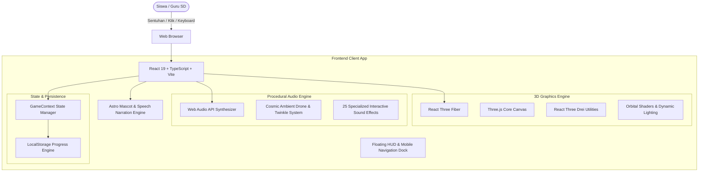

# PlanetKuu — Eksplorasi Tata Surya 3D Interaktif Ramah Anak

> **Karya untuk M-One Telkomsel Competition**  
> **Tema Utama:** *Innovating Education Through Technology*  
> **Subtema:** *Web Education for Kids (untuk anak SD)*  
> **Aplikasi:** [PlanetKuu](https://github.com/JoshNells13/planetkuu)  

---

## Daftar Isi
1. [Ringkasan Eksekutif](#ringkasan-eksekutif)
2. [Latar Belakang & Rumusan Masalah](#latar-belakang--rumusan-masalah)
3. [Solusi Inovatif: PlanetKuu](#solusi-inovatif-planetkuu)
4. [Kesesuaian Tema & Subtema Kompetisi](#kesesuaian-tema--subtema-kompetisi)
5. [Fitur Unggulan Proyek](#fitur-unggulan-proyek)
6. [Pedagogi & Keselarasan Kurikulum Merdeka](#pedagogi--keselarasan-kurikulum-merdeka)
7. [Arsitektur & Tumpukan Teknologi (Tech Stack)](#arsitektur--tumpukan-teknologi-tech-stack)
8. [Struktur Direktori Proyek](#struktur-direktori-proyek)
9. [Panduan Instalasi & Menjalankan Aplikasi](#panduan-instalasi--menjalankan-aplikasi)
10. [Aksesibilitas & Optimalisasi Mobile](#aksesibilitas--optimalisasi-mobile)
11. [Rencana Pengembangan Lanjutan (Roadmap)](#rencana-pengembangan-lanjutan-roadmap)

---

## Ringkasan Eksekutif

**PlanetKuu** adalah platform web edukasi sains interaktif berbasis 3D WebGL yang dirancang khusus untuk siswa Sekolah Dasar (Fase B & C / Kelas 3–6 SD). Mengusung visi *"Menghadirkan Laboratorium Alam Semesta Langsung ke Genggaman Anak Indonesia"*, PlanetKuu meniadakan konsep halaman arahan statis (*landing page*) yang membosankan dan langsung membawa siswa masuk ke dalam simulasi tata surya 3D yang hidup (*living 3D galaxy*).

Melalui kombinasi grafis 3D interaktif real-time, narasi suara ramah anak oleh maskot **Astro**, musik latar kosmik prosedural, 25 efek suara sentuhan haptik, inspektur struktur lapisan inti planet, hingga gamifikasi berbasis misi dan lencana (*mission-based learning*), PlanetKuu mengubah materi astronomi yang abstrak menjadi pengalaman eksplorasi kinestetik yang tak terlupakan.

---

## Latar Belakang & Rumusan Masalah

Pendidikan Ilmu Pengetahuan Alam dan Sosial (IPAS) di tingkat Sekolah Dasar di Indonesia menghadapi tantangan nyata:

1. **Abstraksi Konsep Kosmik**: Materi astronomi seperti rotasi, revolusi, pergantian siang-malam, skala ukuran planet, dan struktur tata surya sulit divisualisasikan hanya melalui diagram 2D statis di buku paket cetak.
2. **Kesenjangan Perangkat & Aksesibilitas**: Sebagian besar media pembelajaran digital interaktif berbasis aplikasi berat (*desktop software* atau *game engine bulky*) yang memerlukan spesifikasi tinggi dan proses instalasi rumit, sehingga tidak ramah untuk smartphone orang tua atau gawai sekolah berdaya rendah.
3. **Rendahnya Keterlibatan Mandiri Siswa**: Konten digital anak saat ini kerap dipenuhi iklan, jebakan distraksi, atau sekadar video satu arah tanpa adanya elemen inkuiri mandiri (*self-directed inquiry learning*).

---

## Solusi Inovatif: PlanetKuu

PlanetKuu hadir menjawab tantangan tersebut dengan memanfaatkan teknologi web modern terkini:

- **Eksplorasi 3D Tanpa Hambatan Instalasi**: Cukup membuka peramban web (*browser*) di smartphone, tablet, atau komputer tanpa perlu unduh aplikasi tambahan (zero installation).
- **Pendekatan Inkuiri Terpandu (Guided Discovery)**: Siswa didampingi oleh **Astro si Sahabat Penjelajah**, maskot astronot cilik dengan suara berbasis *Web Speech API* yang mengajak siswa berkeliling tata surya layaknya studi tur antariksa langsung.
- **Visualisasi Lapisan Dalam Planet (Planet Layer Inspector)**: Anak dapat membedah struktur kerak, mantel, dan inti planet secara interaktif 360 derajat.
- **Audio Sintesis Prosedural Offline**: Musik latar kosmik dan efek suara diciptakan secara sintetis menggunakan *Web Audio API* langsung di dalam memori peramban tanpa mengunduh file MP3/WAV besar, menjadikannya hemat kuota internet dan bekerja optimal di jaringan terbatas.

---

## Kesesuaian Tema & Subtema Kompetisi

### 1. Tema: Innovating Education Through Technology
PlanetKuu mendemokratisasi akses edukasi sains canggih dengan mengubah komputasi grafis 3D berkemampuan tinggi (Three.js & WebGL) ke dalam format web yang ringan dan mudah diakses di seluruh pelosok Indonesia. Teknologi tidak lagi menjadi penghalang, melainkan jembatan yang menghubungkan rasa ingin tahu anak-anak dengan keagungan alam semesta.

### 2. Subtema: Web Education for Kids (untuk anak SD)
Seluruh antarmuka, bahasa narasi, dan mekanika interaksi dirancang khusus untuk karakteristik psikologis dan motorik anak usia 8–12 tahun:
- **Bahasa Ramah Anak & Konseptual Sederhana**: Menghindari rumus rumit; konsep astronomi dijelaskan dengan analogi benda sehari-hari (misal: perbandingan ukuran Bumi dan Matahari dengan kacang polong dan bola basket).
- **Target Sentuh Ergonomis (Touch-Friendly)**: Seluruh tombol pada perangkat mobile memiliki area sentuh minimum 44 x 44 piksel dengan umpan balik suara klik instan.
- **Zona Aman Bebas Distraksi**: 100% bebas iklan, tanpa formulir pendaftaran akun rumit, dan aman bagi anak (*child-safe by design*).
- **Desain Modern Obsidian Hitam Antariksa**: Palet warna galaksi gelap (*deep space black*) yang elegan tanpa emoji sembarangan, menjaga wibawa edukasi sains sekaligus menawan secara visual.

---

## Fitur Unggulan Proyek

### 1. Interactive 3D Solar System Engine
- Simulasi orbital presisi yang menampilkan Matahari dan delapan planet (Merkurius, Venus, Bumi, Mars, Jupiter, Saturnus dengan sistem cincin, Uranus dengan kemiringan aksial unik, dan Neptunus).
- OrbitControls dinamis: putar sudut pandang 360 derajat, cubit untuk perbesar/perkecil (*pinch to zoom*), dan geser sudut pandang bebas.
- Kendali simulasi: Jeda (*pause*), putar ulang, serta percepat rotasi/revolusi (0.5x, 1x, 2x, 5x).
- Pengalih garis orbit (*orbit lines*) dan label nama planet 3D interaktif.

### 2. Tur Berkeliling Dipandu Astro (Astro Guided Tour)
- Fitur tur berpemandu otomatis dan manual berisi 10 perhentian antariksa terkurasi:
  1. Matahari — Inti Kehidupan Tata Surya
  2. Merkurius — Pelari Cepat yang Panas & Dingin
  3. Venus — Saudara Kembar Bumi yang Membara
  4. Bumi & Bulan — Rumah Kehidupan Kita
  5. Mars — Gurun Karat Berwarna Merah
  6. Sabuk Asteroid — Batuan Pembentuk Tata Surya
  7. Jupiter — Sang Raksasa Gas Pelindung
  8. Saturnus — Mahkota Cincin Permata Kosmik
  9. Uranus & Neptunus — Penjaga Dingin di Tepi Tata Surya
  10. ISS & Pangkalan Antariksa Masa Depan
- Dilengkapi pembacaan teks suara berbahasa Indonesia langsung (*text-to-speech* otomatis dengan opsi bisu), kotak fakta seru komparasi dunia nyata, dan navigasi linier.

### 3. Planet Inspector 3D (Bedah Lapisan Inti Planet)
- Fitur inspektur planet mendalam:
  - **Mode Permukaan 3D**: Menjelajahi fitur geologis dan titik penting (*hotspots*) seperti Bintik Merah Raksasa Jupiter, Gunung Olympus di Mars, atau Kawah Caloris di Merkurius.
  - **Mode Lapisan Inti 3D**: Membelah planet secara visual untuk mengamati kerak (*crust*), mantel silikat (*mantle*), dan inti besi/nikel cair (*core*) beserta penjelasannya.

### 4. Laboratorium Sejarah Sains & Easter Eggs Tersembunyi
Menumbuhkan apresiasi anak terhadap tonggak sejarah sains manusia:
- **Komet Halley**: Mengetuk komet es melintas untuk mengamati sublimasi ekor gas.
- **Wahana Voyager 1**: Mengamati piringan emas (*Golden Record*) wahana buatan manusia terjauh di ruang antarbintang.
- **Stasiun Luar Angkasa Internasional (ISS)**: Menemukan laboratorium mengorbit tempat para astronaut tinggal dan melakukan eksperimen gravitasi mikro.
- **Teleskop Antariksa James Webb (JWST)**: Mempelajari cermin heksagonal emas pelacak cahaya bintang purba.
- **Pendaratan Apollo 11 di Bulan**: Meneliti jejak kaki astronaut pertama, modul pendarat *Eagle*, dan plakat perdamaian Bulan.
- **Bintang Jatuh (Meteor)**: Menangkap meteor melintas berkecepatan tinggi untuk melatih refleks motorik anak.
- **Sabuk Asteroid & Sabuk Kuiper**: Berinteraksi dengan jutaan batuan luar angkasa dan planet kerdil Pluto.

### 5. Gamifikasi Pembelajaran Berbasis Misi (Misi Penjelajah Cilik)
- **Sistem Pengalaman (XP) & Peringkat**: Dari *Kadet Pemula*, *Pengamat Bintang*, *Pelacak Orbit*, hingga *Laksamana Bintang*.
- **5 Misi Kurikulum Berjenjang**:
  - Misi 1: Mencari Planet Merah (Identifikasi Mars)
  - Misi 2: Penjaga Orbit (Memahami revolusi mengitari Matahari)
  - Misi 3: Misteri Siang dan Malam (Eksperimen rotasi Bumi)
  - Misi 4: Rahasia Cincin Saturnus (Eksplorasi cincin es partikel)
  - Misi 5: Tantangan Kuis Tata Surya (Evaluasi pemahaman konsep)
- **10 Koleksi Lencana (Badges)**: Penghargaan visual menarik yang tersimpan permanen di penyimpanan lokal (*localStorage*) tanpa risiko hilang saat laman dimuat ulang.

### 6. Audio Kosmik Prosedural (BGM Ambient & 25 Sound Effects)
- **Cosmic BGM Engine**: Musik instrumental luar angkasa santai berbasis gelombang sinus dan segitiga polifonik harmonis (43 Hz – 392 Hz) dengan denting starlight twinkle.
- **25 Efek Suara Haptik Unik**:
  - Suara klik sentuhan adaptif dengan variasi frekuensi acak alami.
  - Resonansi surya (*solar pulse*) saat menyentuh Matahari.
  - Bunyi telemetri radio astronaut retro (*NASA radio telemetry*) pada ISS dan Bulan.
  - Sapuan optik sensor teleskop (*telescope scan chime*) pada JWST.
  - Sinyal antarbintang pada Voyager 1 dan desingan es Komet Halley.
  - Suara vokal ceria robotik maskot Astro saat berinteraksi.
  - Nada melodi keberhasilan kuis dan bunyi empuk ramah anak saat salah menjawab.
  - Hitungan mundur peluncuran roket dan deru gemuruh mesin roket menembus orbit.

### 7. Ensiklopedia & Alat Komparasi Planet
- Katalog astronomi komprehensif berisi data radius, jarak dari Matahari, suhu rata-rata, gravitasi, jumlah satelit alami, dan lama rotasi/revolusi.
- **Komparasi 2 Planet Berdampingan**: Anak dapat memilih dua planet mana saja untuk membandingkan ukuran dan karakteristik fisik secara langsung.

### 8. Simulator Peluncuran Roket Bumi
- Simulasi lepas landas roket dengan hitungan mundur telemetri, animasi pembakaran bahan bakar bertingkat, penembusan atmosfer, hingga penempatan satelit di orbit stabil Bumi.

---

## Pedagogi & Keselarasan Kurikulum Merdeka

PlanetKuu dirancang selaras dengan **Capaian Pembelajaran (CP) IPAS Kurikulum Merdeka**:

| Elemen Kurikulum | Capaian Pembelajaran SD (Fase B/C) | Penerapan di PlanetKuu |
| :--- | :--- | :--- |
| **Pemahaman IPAS** | Mengidentifikasi urutan planet dan karakteristik tata surya. | Eksplorasi 3D 8 planet dengan data visual dan ukuran relatif. |
| **Sistem Bumi & Antariksa** | Memahami gerak rotasi dan revolusi Bumi serta dampaknya (siang-malam & musim). | Kontrol interaktif rotasi sumbu Bumi dan garis revolusi mengelilingi Matahari. |
| **Keterampilan Proses** | Mengamati, memprediksi, membandingkan, dan mengomunikasikan hasil penyelidikan. | Fitur *Bandingkan 2 Planet*, inspeksi lapisan dalam, dan kuis refleksi interaktif. |
| **Profil Pelajar Pancasila** | Bernalar Kritis, Mandiri, dan Kreatif. | Model inkuiri mandiri berbasis misi dan pemecahan misteri antariksa. |

---

## Arsitektur & Tumpukan Teknologi (Tech Stack)



- **Frontend Core**: React 19, TypeScript, Vite
- **3D Graphics & Rendering**: Three.js, `@react-three/fiber`, `@react-three/drei`
- **Audio Synthesizer Engine**: Native Web Audio API (zero external assets, 0ms latency)
- **Voice Narration**: Web Speech API (`SpeechSynthesisUtterance` id-ID)
- **Styling Architecture**: Vanilla CSS murni dengan CSS Custom Properties (*Tokens: Galaxy Obsidian, Starlight Silver, Solar Gold*)
- **Icons**: Lucide React
- **Confetti Celebration**: Canvas Confetti

---

## Struktur Direktori Proyek

```text
planetkuu/
├── index.html                   # Entry point dokumen HTML5 & SEO Meta
├── package.json                 # Konfigurasi dependensi & skrip build
├── tsconfig.json                # Konfigurasi TypeScript
├── vite.config.ts               # Konfigurasi Vite bundler
├── public/                      # Aset statis favicon dan tekstur
└── src/
    ├── main.tsx                 # Root React mounting
    ├── App.tsx                  # Komponen orkestrator utama PlanetKuu
    ├── App.css                  # Desain sistem responsif, Dock, & Glassmorphism
    ├── index.css                # Variabel CSS Tokens & Reset Global
    ├── components/
    │   ├── 3d/                  # Komponen 3D Scene WebGL
    │   │   ├── SolarSystem.tsx  # Tata surya utama & orbit
    │   │   ├── Sun.tsx          # Matahari bersinar dengan corona
    │   │   ├── Planet.tsx       # Model 8 planet, rotasi, atmosfer
    │   │   ├── AsteroidBelt.tsx # Sabuk Asteroid dinamis
    │   │   ├── KuiperBelt.tsx   # Sabuk Kuiper dingin
    │   │   ├── CosmicEasterEggs.tsx # Meteor, ISS, JWST
    │   │   ├── HalleyComet.tsx  # Komet Halley dengan ekor gas
    │   │   ├── VoyagerProbe.tsx # Wahana Voyager 1 & Golden Record
    │   │   ├── Pluto.tsx        # Planet kerdil Pluto & satelit Charon
    │   │   └── PlanetInspector3D.tsx # Bedah lapisan dalam & hotspot
    │   ├── guide/               # Tur Berkeliling & Panduan
    │   │   ├── AstroGuidedTour.tsx # Tur terpandu interaktif
    │   │   └── CelestialGuideModal.tsx # Panduan pencarian objek antariksa
    │   ├── mascot/              # Maskot Astronaut Astro
    │   │   ├── AstroMascot.tsx  # Avatar SVG kartun 3D responsif
    │   │   └── AstroDialogue.tsx# Balon dialog kontekstual Astro
    │   ├── modals/              # Dialog Modal Edukasi
    │   │   ├── PlanetDetailModal.tsx   # Detail planet & aktivitas
    │   │   ├── MissionDashboard.tsx    # Dasbor misi penjelajah
    │   │   ├── AchievementsModal.tsx   # Lemari piala & lencana
    │   │   ├── EncyclopediaModal.tsx   # Ensiklopedia & perbandingan
    │   │   ├── QuizModal.tsx           # Kuis evaluasi pemahaman
    │   │   ├── RocketLaunchOverlay.tsx # Simulator peluncuran roket
    │   │   ├── SpaceStationModal.tsx   # Info edukasi stasiun ISS
    │   │   ├── TelescopeModal.tsx      # Info edukasi JWST
    │   │   ├── LunarEasterEggModal.tsx # Rekonstruksi Apollo 11
    │   │   ├── AstroTalkModal.tsx      # Tanya jawab astronomi
    │   │   └── SettingsModal.tsx       # Pengaturan audio & grafis
    │   └── ui/                  # Komponen Navigasi & HUD
    │       ├── FloatingHUD.tsx  # Header mengambang & Mobile Dock
    │       └── WebGLFallback.tsx# Tampilan alternatif jika WebGL mati
    ├── context/
    │   └── GameContext.tsx      # Manajemen state terpusat & audio binding
    ├── data/                    # Basis Pengetahuan Astronomi
    │   ├── planets.ts           # Data sains 8 planet & Matahari
    │   ├── missions.ts          # Data misi edukatif & lencana
    │   ├── tour.ts              # Naskah 10 perhentian Tur Astro
    │   ├── quiz.ts              # Bank soal kuis Kurikulum Merdeka
    │   └── guide.ts             # Data panduan objek langit
    ├── types/                   # Definisi TypeScript
    │   ├── astronomy.ts         # Tipe planet, orbit, lapisan, koordinat
    │   └── gamification.ts      # Tipe misi, level, lencana, preferensi
    └── utils/                   # Utilitas Sistem
        ├── sound.ts             # Web Audio API Synthesizer (25 SFX)
        ├── bgm.ts               # Mesin Musik Kosmik Prosedural
        ├── speech.ts            # Web Speech API Narator Indonesia
        ├── textures.ts          # Generator tekstur prosedural planet
        └── storage.ts           # Penyimpanan lokal terenkapsulasi
```

---

## Panduan Instalasi & Menjalankan Aplikasi

Pastikan pada komputer Anda telah terpasang **Node.js** (versi 18.0 atau lebih baru) dan pengelola paket `npm`.

### 1. Kloning Repositori
```bash
git clone https://github.com/JoshNells13/planetkuu.git
cd planetkuu
```

### 2. Instalasi Dependensi
```bash
npm install
```

### 3. Menjalankan di Server Pengembangan Lokal
```bash
npm run dev
```
Setelah perintah dijalankan, buka peramban Anda di alamat yang tertera (biasanya `http://localhost:5173`).

### 4. Membangun Bundel Produksi (*Production Build*)
```bash
npm run build
```
Hasil kompilasi siap publikasi akan berada di folder `dist/` dengan ukuran bundel yang telah dioptimasi dan terkompresi secara efisien.

---

## Aksesibilitas & Optimalisasi Mobile

PlanetKuu memprioritaskan prinsip **Mobile-First Responsive Design**:
- **Mobile Navigation Dock**: Tombol pintas navigasi di bagian bawah layar yang mudah dijangkau oleh ibu jari anak saat memegang ponsel dalam mode satu tangan maupun dua tangan.
- **Dukungan Sentuhan Multi-Gesture**: Dukungan penuh sentuhan satu jari untuk rotasi, dua jari untuk perbesar (*pinch zoom*), dan ketukan instan untuk pemilihan planet.
- **Fallback Ramah Perangkat Lawas**: Dilengkapi deteksi kapabilitas WebGL otomatis (`WebGLFallback.tsx`). Jika perangkat lawas tidak mendukung akselerasi 3D, aplikasi tetap menyajikan katalog ensiklopedia sains secara lancar.
- **Pengaturan Kualitas Grafis**: Pengguna dapat mengatur tingkat ketajaman grafis (*Tinggi, Sedang, Rendah*) di menu pengaturan untuk menghemat baterai perangkat.

---

## Rencana Pengembangan Lanjutan (Roadmap)

1. **Mode Virtual Reality (WebXR)**: Memungkinkan siswa merasakan pengalaman berada di atas permukaan Mars atau cincin Saturnus menggunakan kacamata VR kardus murah (*Google Cardboard*).
2. **Kuis Kolaboratif Kelas (Multiplayer Classroom)**: Integrasi ruang kuis bersama di mana guru dapat melihat capaian belajar siswa secara real-time.
3. **Dukungan Audio Bahasa Daerah**: Menambahkan opsi bahasa daerah (seperti Bahasa Jawa, Sunda, dll.) pada narasi maskot Astro untuk memperkuat literasi kebudayaan nusantara.

---

## Tim Pengembang

Karya ini disusun dan dikembangkan dengan sepenuh dedikasi untuk memajukan pendidikan sains anak-anak Indonesia dalam ajang **M-One Telkomsel Competition**.

*Hak Cipta © 2026 PlanetKuu Team. Berlisensi di bawah MIT License.*
